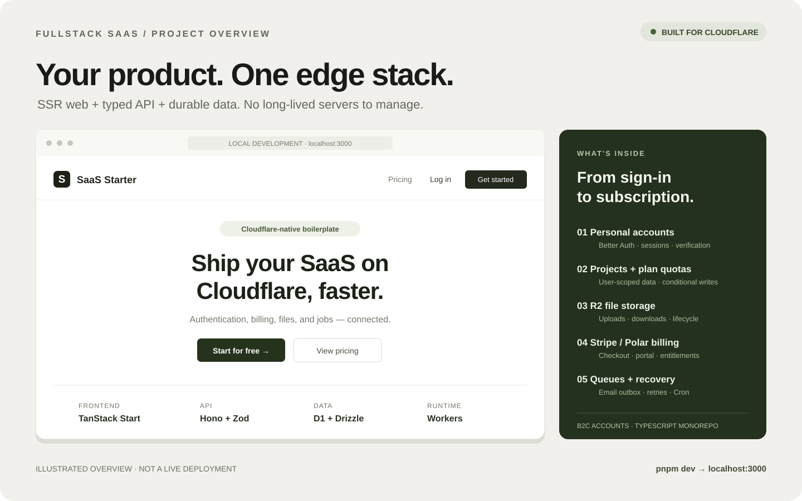
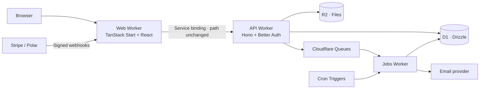

<div align="center">

# Fullstack SaaS

**Build your product. Keep your stack on Cloudflare.**

A fullstack SaaS starter with server-rendered React, a typed API, authentication,
subscription billing, file storage, and background jobs — built for Workers.


[Preview](#project-preview) · [Quickstart](#quickstart) · [Architecture](#architecture) · [Documentation](#documentation) · [Security](#security)

</div>

## Project preview



*Illustrated project overview, not a live deployment or a screenshot. The application currently uses the “SaaS Starter” brand; customize it for your product.*

Run the full application locally at **[localhost:3000](http://localhost:3000)** using the quickstart below. Explore the landing page and pricing, then sign in with a seeded local demo account to try the dashboard, projects, files, account settings, and billing screens.

**Demo scope:** local development only. This repository does not provide a hosted public demo. Billing checkout, OAuth, and email delivery require your own provider configuration. Some landing-page marketing copy remains template content; the implemented feature list below is the source of truth.

## What's included

- **SSR web application** — TanStack Start, React, Tailwind CSS, and shared shadcn-based UI primitives.
- **Typed API** — Hono routes, shared Zod contracts, and a hand-maintained TypeScript SDK.
- **Personal accounts** — Better Auth integration, password reset, verification emails, profile/password updates, session management, metadata export, and guarded deletion.
- **Projects** — user-scoped CRUD with plan-aware limits enforced through conditional database writes.
- **File storage** — R2 uploads, downloads, deletion, upload lifecycle tracking, and plan-aware storage quotas. Local development uses the Worker binding without S3 credentials.
- **Billing adapters** — Polar or Stripe, subscription entitlements, checkout, customer portal, and signed, deduplicated webhook processing.
- **Background processing** — Cloudflare Queues and Cron, durable email outbox, retry/recovery paths, and dead-letter handling.
- **Request protection** — origin checks for cookie-authenticated writes, D1-backed rate limits, and optional Turnstile verification.
- **Developer tooling** — setup wizard, local bootstrap, environment checks, secret scanning, test suites, and explicit staging/production deployment commands.

> **Account model:** B2C, scoped by `user_id`. Organizations, invitations, and role-based team access are not implemented. See the [extension guide](docs/extending.md) before introducing an organization model.

## Quickstart

### Requirements

- Node.js **22 or newer**
- **pnpm 12.14.0**, as pinned in `package.json`
- Git and access to this repository

No Docker, PostgreSQL server, or Cloudflare account is required for the normal local-development path. Cloudflare bindings run through the local development runtime.

```bash
git clone https://github.com/bangadam/fullstack-saas-starter.git
cd fullstack-saas-starter

pnpm install
pnpm wizard --yes
pnpm bootstrap
pnpm dev
```

Open **[http://localhost:3000](http://localhost:3000)**.

The wizard creates ignored local configuration. Bootstrap prepares Worker environment files, applies local D1 migrations, and seeds demo data. Review existing local configuration before re-running setup in an established checkout; never overwrite real credentials with example values.

### Local demo accounts

After seeding, use `budi@example.com` or `sari@example.com`, with the development-only password `password123`.

These are **public fixture credentials for local development**, not production credentials. Never seed these accounts into a publicly accessible deployment.

```bash
pnpm check           # Local prerequisites and configuration checks
pnpm smoke           # HTTP checks against the running local stack
pnpm smoke:lifecycle # Local account/session/export/file lifecycle checks
```

**Naming note:** `pnpm doctor` and `pnpm setup` are pnpm built-ins. This project's commands are `pnpm check` and `pnpm wizard`.

## Architecture



The Web Worker is the public entry point. `/api/*` and `/webhooks/*` are forwarded over a service binding **without rewriting their paths**. Better Auth uses `/api/auth`. The API and Jobs Workers own their server-side credentials; secrets never belong in browser-facing configuration.

| Area | Responsibility |
| --- | --- |
| `apps/web` | Pages, SSR, application UI, same-origin proxy |
| `apps/api` | Authentication, domain routes, billing webhooks, request guards |
| `apps/jobs` | Queue consumers, Cron, recovery and cleanup |
| `packages/contracts`, `packages/sdk` | Shared DTOs and typed client |
| `packages/db`, `packages/domain` | Schema, migrations, business rules, repository ports |
| `packages/auth`, `packages/billing` | Authentication and payment-provider integrations |
| `packages/email`, `packages/storage`, `packages/jobs` | Email templates, R2 utilities, job contracts |
| `packages/config`, `packages/cli`, `packages/ui` | Configuration, operator tooling, shared components |
| `scripts`, `infra/cloudflare` | Local lifecycle, smoke checks, deployment inputs |

See [architecture](docs/architecture.md) for routing, data boundaries, and operational trade-offs.

## Development commands

| Command | Purpose |
| --- | --- |
| `pnpm dev` / `pnpm stop` / `pnpm restart` | Manage the local stack |
| `pnpm wizard --yes` | Generate per-clone configuration |
| `pnpm bootstrap` | Prepare local environment, database, and fixtures |
| `pnpm check` | Diagnose local setup |
| `pnpm test` | Workspace Vitest suites |
| `pnpm test:scripts` | Operator and smoke-script tests |
| `pnpm typecheck` / `pnpm lint` / `pnpm build` | Workspace quality gates |
| `pnpm scan:secrets` | Scan tracked working-tree files for supported credential patterns |
| `pnpm db:migrate` / `pnpm db:seed` | Local D1 migrations and demo data |
| `pnpm deploy:staging --preflight` | Validate staging inputs without cloud mutations |
| `pnpm operations inspect --env local --execute` | Read aggregate local recovery metrics |

Before submitting a behavior change, add a failing test in the owning package, implement the change, then run:

```bash
pnpm test
pnpm test:scripts
pnpm typecheck
pnpm lint
pnpm scan:secrets
```

Browser flows in [`apps/web/e2e/flows.mjs`](apps/web/e2e/flows.mjs) are agent-driven, not a standalone CI browser suite. UI-route changes require both a full reload and client-side navigation check.

## Deployment

Deployment is an **explicit operator action**, not a side effect of installation or repository creation.

1. Provision separate Cloudflare resources for the target environment.
2. Configure Worker secrets and payment/email providers outside Git.
3. Review the target Wrangler environment and D1 migrations.
4. Run the deployment preflight and follow the [deployment guide](docs/deployment.md).
5. Configure protected GitHub environments before enabling production workflows.

The included workflows are manually triggered. Setup does not provision cloud resources, configure GitHub environment reviewers, or prove real payment-provider/email delivery behavior.

## Security

- Commit **only placeholder examples** such as `.env.example` and `.dev.vars.example`.
- Keep `.env.local`, `.dev.vars`, generated `saas.config.ts`, database state, and credentials on your machine or in an appropriate secret store.
- Never commit `.wrangler`, `.turbo`, build output, or runtime logs.
- Run `pnpm scan:secrets` before committing. Its supported-pattern scan does **not** replace review of untracked files, Git history, or a dedicated secret-scanning service.
- Never paste tokens, session cookies, customer exports, or provider payloads into issues or screenshots.
- If a credential has reached Git history, revoke/rotate it; removing the latest copy is not sufficient.

Read [SECURITY.md](SECURITY.md) for private reporting and [the operator security guide](docs/security.md) for implementation details.

## Documentation

Operator documentation is maintained in **Bahasa Indonesia**; source code and the repository overview use English.

- [Documentation index](docs/README.md)
- [Setup](docs/setup.md)
- [Architecture](docs/architecture.md)
- [Deployment](docs/deployment.md)
- [Security](docs/security.md)
- [Operations and recovery](docs/operations.md)
- [Adding a domain module](docs/extending.md)
- [Self-service verification notes](docs/verification-self-service.md)
- [Contributor guide](CONTRIBUTING.md)
- [AI agent operating guide](AGENTS.md)

## Project boundaries

This is a customizable starter, not a production-readiness certification. Provider credentials, resource provisioning, billing reconciliation, observability, and deployment reviews remain the operator's responsibility. External email deduplication has a bounded provider window; ambiguous sends require reconciliation. Account deletion freezes uploads/checkouts, waits at least 70 minutes, and requires billing state to be reconciled.

No open-source license is currently granted. Repository access does not imply permission to redistribute or sublicense the code.
